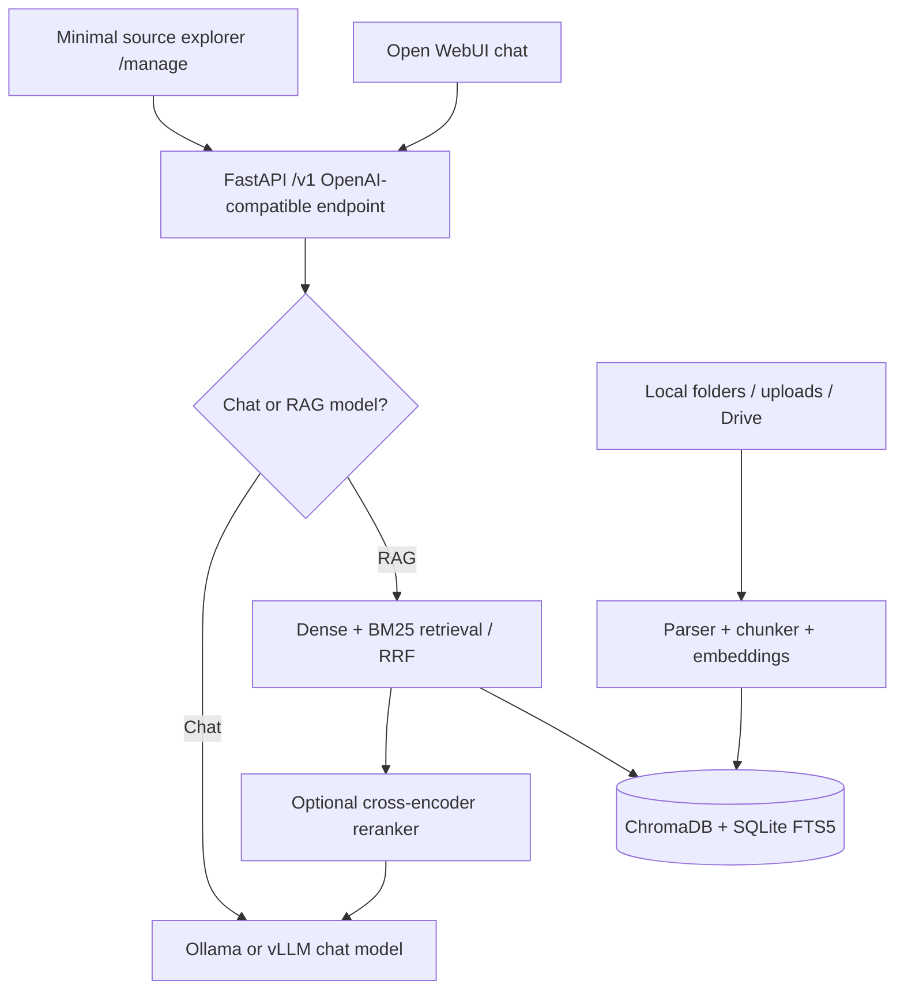

# LocalRAG Engine v1.2.1 — Chat + RAG + Reproducible Benchmark

**One interface for direct chat and document-grounded RAG — not an AI agent.** Python handles model routing, ingestion, retrieval, reranking and citations. [Open WebUI](https://github.com/open-webui/open-webui) supplies the familiar chat interface, so there is no custom React/TypeScript application to maintain.

Designed for a **2020 M1 MacBook Pro (16 GB unified memory)**, while keeping the generation backend switchable between **Ollama**, **vLLM-Metal** on Apple Silicon and **vLLM** on accelerated Linux/HPC servers.

## Fastest start: macOS without Docker

1. Install [Ollama](https://ollama.com/download/mac) and **Python 3.12** (e.g. `brew install python@3.12`). Start Ollama.
2. Download a chat model and the embedding model (once):

   ```bash
   ollama pull qwen3.5:9b-q4_K_M
   ollama pull embeddinggemma
   ```

3. From this project's root directory:

   ```bash
   bash scripts/setup-native.sh   # Once: creates two Python 3.12 environments.
   bash scripts/run-native.sh     # Every launch: starts API, then Open WebUI.
   ```

4. Open **<http://127.0.0.1:8080>** for chat or **<http://127.0.0.1:8000/manage>** to upload, explore and sync files. Select **`chat/ollama/qwen3.5:9b-q4_K_M`** for free chat, or **`rag/ollama/qwen3.5:9b-q4_K_M`** for grounded document Q&A.

`run-native.sh` checks that Ollama is running, waits for the RAG API to become healthy **before** launching Open WebUI, and stops both processes with `Ctrl+C`. If port 8000 or 8080 is already in use, stop the old server first. You do not need to activate virtual environments manually.

The native script also configures **Open WebUI's own** document embeddings to use Ollama's `embeddinggemma`, avoiding its local PyTorch/MPS embedding path. Open WebUI attachments and LocalRAG's `/manage` uploads **still maintain separate indexes**; use `/manage` for documents you want to query with the `rag/...` models.

**Model discovery is automatic:** after `ollama pull`, refresh Open WebUI (allow up to 30 seconds for the discovery cache). Every installed Ollama model with the `completion` capability appears twice in Open WebUI: `chat/ollama/<actual-model-name>` for direct generation **without documents**, and `rag/ollama/<actual-model-name>` for **strict RAG**. Embedding-only models such as `embeddinggemma` are excluded. vLLM providers work the same way through their `/v1/models` endpoint.

### Chat or RAG? Choose in the model dropdown

| Selected model | Documents required? | Behavior |
| --- | --- | --- |
| `chat/ollama/qwen3.5:9b-q4_K_M` | No | Direct conversation via LocalRAG API → Ollama. No retrieval or citations. |
| `rag/ollama/qwen3.5:9b-q4_K_M` | Yes | Retrieval and grounded answers with citations; no unsupported free-form fallback. |
| `chat/ollama/huihui_ai/qwen3.5-abliterated:9b` | No | Direct chat with a different installed model. |
| `rag/ollama/huihui_ai/qwen3.5-abliterated:9b` | Yes | RAG with that same installed model. |

The prefix `chat/` or `rag/` selects behavior; the rest is the automatically discovered provider/model identifier. Open WebUI always connects to **LocalRAG's `/v1` API**, not directly to Ollama. Therefore **keep `ENABLE_OPENAI_API=true` and `ENABLE_OLLAMA_API=false`**. Older saved conversations using `localrag/ollama/...` still resolve to **strict RAG**, but use the newly listed IDs for new conversations.

**Upgrading from v1.0:** If you reuse your existing `config.yaml`, add `discover: true` under the `id: ollama` provider and remove or disable separate hardcoded profiles for individual Ollama models to prevent duplicate entries. Keep your existing `data/` and `documents/` folders if you want to retain the index and files. The new native script uses dedicated `.venv-rag312` and `.venv-webui312` environments; it does not delete earlier environments.

> **Scope:** Text RAG from PDFs, Word documents, Markdown and TXT; configured local folders, uploads and optional read-only Google Drive folders. There is no autonomous agent, tool calling, OCR, image/video understanding or production multi-user authentication.

## Architecture



The embeddings model is independently configurable; switching the **chat** model does *not* invalidate the document index. Switching the **embedding** model or chunk settings **does** require `localrag reindex`.

## Project layout

```text
localrag-engine/
├── README.md                   # This guide
├── config.example.yaml         # Models, sources, retrieval and reranker
├── compose.yaml                # RAG API + Open WebUI; models run separately
├── Dockerfile
├── pyproject.toml              # Python package + optional dependencies
├── documents/                  # Your local documents (Git ignored)
├── src/localrag/
│   ├── api.py                  # Upload, browse, sync, job monitoring
│   ├── openai_api.py           # /v1/models and /v1/chat/completions
│   ├── discovery.py            # Ollama/vLLM model enumeration and TTL cache
│   ├── config.py               # Validated YAML configuration
│   ├── engine.py               # Index lifecycle, RRF, optional reranking
│   ├── providers.py            # Ollama and OpenAI-compatible HTTP clients
│   ├── parsing.py              # PDF/DOCX/MD/TXT parsing and chunking
│   ├── storage.py              # SQLite documents + BM25/FTS5
│   ├── google_drive.py         # Optional read-only Drive connector
│   ├── cli.py                  # Serve, sync, reindex, status
│   ├── metrics.py              # Recall@k, MRR@k, nDCG@k
│   └── static/manage.html      # Small source-management UI (no JS build)
├── evaluation/evaluate.py      # Retrieval evaluator for your own labeled documents
├── evaluation/benchmark_synthetic.py  # Public synthetic retrieval benchmark
├── evaluation/fixtures/       # Ten synthetic documents and 70 labeled questions
├── evaluation/results/        # Measured offline BM25 baseline, in JSON
├── scripts/check_lines.py      # CI check: <=350 lines per Python module
├── scripts/setup-native.sh     # One-time native Python 3.12 environment setup
├── scripts/run-native.sh       # Start both services in the correct order
└── tests/                      # Unit and API contract tests
```

Every project Python file is **under 350 lines**. Modules are intentionally small, commented and independently testable.

## 1. Download the models

Model weights are **not included** in this repository or Docker image. You download them using the inference server of your choice. Downloading requires internet once; later local inference can run offline.

### Option A: Ollama (recommended for a 16 GB M1 Mac)

Install [Ollama](https://ollama.com/download/mac), then in Terminal:

```bash
ollama pull qwen3.5:9b-q4_K_M
ollama pull embeddinggemma
ollama list
```

- `qwen3.5:9b-q4_K_M` is a ~6.6 GB quantized *generation* model. It is discovered automatically in the UI.
- `embeddinggemma` generates vectors used in the ChromaDB index; its vectors are not interchangeable with another embedding model.
- `thinking: false` in the Ollama provider avoids long visible reasoning traces. With some models/versions, thinking behavior may differ.
- Keep other large model processes closed on a 16 GB machine. The optional reranker needs more RAM.

You can try other models, including community *abliterated/uncensored* variants, by pulling the exact tag from [Ollama's catalog](https://ollama.com/search). **No YAML edit is needed to select a newly downloaded Ollama model.** These models are third-party releases: check their license, provenance, actual size and quality before use. **Do not change the embeddings model** just to experiment with chat models.

Verify the local server:

```bash
curl http://127.0.0.1:11434/api/tags
```

If running with Docker Compose, Ollama must be reachable **from the RAG container**. On macOS you may need to restart Ollama listening on an interface accessible to Docker Desktop (rather than only `127.0.0.1`), for example using Ollama's `OLLAMA_HOST=0.0.0.0:11434` setting. This exposes the port to network interfaces: use a firewall/trusted network. See [Ollama FAQ](https://docs.ollama.com/faq) and [Docker Desktop host networking](https://docs.docker.com/desktop/features/networking/). For a strictly loopback-only setup, use the **native** path below.

### Option B: vLLM-Metal on Apple Silicon

Apple Silicon requires the **vLLM-Metal** backend; generic Linux/CUDA vLLM instructions are *not* the Mac install procedure. Its current installation guide requires **macOS 15+**.

```bash
brew tap vllm-project/vllm-metal https://github.com/vllm-project/vllm-metal
brew install vllm-project/vllm-metal/vllm-metal
```

Start the server on **port 8001** (8000 is reserved for the LocalRAG API):

```bash
vllm serve mlx-community/Qwen3.5-9B-MLX-4bit \
  --host 127.0.0.1 --port 8001 \
  --max-model-len 8192 --max-num-batched-tokens 2048 \
  --reasoning-parser qwen3
```

The first run downloads the model from Hugging Face (roughly **6 GB**). The 8k context and 2048 batched-token limit are drawn from the project's **16 GB Mac recipe**. If you want Docker to reach this model server, use an appropriate accessible binding instead of `127.0.0.1`, and secure the exposed service.

Edit `config.yaml`:

```yaml
llm:
  default: vllm-metal
  providers:
    - id: ollama
      provider: ollama
      enabled: true
      discover: true
      base_url: http://localhost:11434
    - id: vllm-metal
      provider: openai
      enabled: true
      discover: true
      base_url: http://localhost:8001/v1
```

The file you copy already includes both backend profiles: normally you only change `enabled: true` for `vllm-metal`, then restart the API. Its available models appear in the same Open WebUI model selector, while Ollama continues to provide `embeddinggemma` unless you choose a different embedding endpoint.

Official documentation: [vLLM-Metal installation](https://docs.vllm.ai/projects/vllm-metal/en/latest/installation/) · [16 GB recipe](https://docs.vllm.ai/projects/vllm-metal/en/latest/recipes/).

### Option C: vLLM on GPU/HPC systems

Install and run [vLLM on the accelerator node](https://docs.vllm.ai/en/latest/getting_started/quickstart/) using its supported Linux/CUDA/ROCm/other accelerator stack. For example, **if the model is supported and your GPUs have sufficient memory**:

```bash
vllm serve Qwen/Qwen3.5-9B --host 0.0.0.0 --port 8001 --api-key YOUR_SECRET
```

On first use, vLLM downloads compatible model weights from Hugging Face automatically. In `config.yaml`, enable `vllm-hpc`, set its `base_url` to a reachable **authenticated gateway**, and set `VLLM_API_KEY` as an environment variable. The example assumes OpenAI-compatible `/v1/chat/completions`; infrastructure, schedulers, GPUs and ingress are managed separately. **Never expose an unauthenticated inference endpoint to the public internet.**

## 2. Start with Docker Compose

Prerequisites: Docker Desktop or Docker Engine + Compose plugin, a running model server, and the models downloaded above. Docker runs **the RAG API and UI**; macOS inference stays native to retain Metal acceleration.

```bash
cp config.example.yaml config.yaml
docker compose up -d --build
```

Open:

| URL | Purpose |
| --- | --- |
| <http://127.0.0.1:3000> | Open WebUI chat (create an account on first launch) |
| <http://127.0.0.1:8000/manage> | Upload, explore folders, sync sources |
| <http://127.0.0.1:8000/docs> | Interactive REST API documentation |
| <http://127.0.0.1:8000/v1/models> | Discovered chat and RAG model choices |

Select **`chat/ollama/qwen3.5:9b-q4_K_M`** for direct chat or **`rag/ollama/qwen3.5:9b-q4_K_M`** for document Q&A. If its model list is empty, check `docker compose logs rag-api webui`, and in Open WebUI's **Admin Settings → Connections** verify the OpenAI-compatible URL is `http://rag-api:8000/v1` *from the container*. Open WebUI stores UI settings in a persistent named Docker volume; UI edits can override environment defaults on later restarts.

> **Important:** `docker compose up` does **not** download and start the native Ollama/vLLM model server for you. `ollama pull ...`, a running server, and the initial `config.yaml` copy are required first.

The default Compose environment overrides `localhost` URLs to `host.docker.internal`, specifically for the Ollama, vLLM-Metal and embedding backends. To use a remote HPC provider, edit its `base_url` in YAML; it is not overridden by default.

```bash
docker compose ps
docker compose logs -f rag-api
docker compose down        # Stops services; does NOT delete volumes/data.
```

## 3. Start without Docker

Use **Python 3.12** for both applications (Open WebUI does not support Python 3.14). From the project root:

```bash
bash scripts/setup-native.sh    # First installation only.
bash scripts/run-native.sh      # Starts the RAG API, waits, then starts the UI.
```

The first script creates `.venv-rag312` and `.venv-webui312` using Python 3.12. It preserves any existing `config.yaml`. The second script requires the Ollama application to be running and keeps both processes together until `Ctrl+C`.

This yields **<http://127.0.0.1:8000/manage>** for document management and **<http://127.0.0.1:8080>** for conversations. Click *Open chat* in `/manage`; its link follows `app.webui_url` in YAML and defaults to port 8080, not Docker's port 3000.

For debugging, the two processes can also run in separate terminals (from the project root):

```bash
# Terminal A: start this first, and leave it running.
LOCALRAG_CONFIG="$PWD/config.yaml" .venv-rag312/bin/python -m localrag.cli serve
```

```bash
# Terminal B: start only after http://127.0.0.1:8000/v1/models responds.
ENABLE_PERSISTENT_CONFIG=false ENABLE_OPENAI_API=true ENABLE_OLLAMA_API=false \
OPENAI_API_BASE_URLS=http://127.0.0.1:8000/v1 OPENAI_API_KEYS=localrag-local \
OPENAI_API_CONFIGS='{"0":{"enable":true,"model_ids":[]}}' \
DATA_DIR="$PWD/data/open-webui" .venv-webui312/bin/open-webui serve --port 8080
```

The start script uses those Open WebUI settings automatically and avoids persisting stale connection URLs. Chat history remains stored in `data/open-webui`; settings edited inside Open WebUI while persistent config is disabled may not survive a restart. For upstream installation details, see the [official Quick Start](https://docs.openwebui.com/getting-started/quick-start/).

You can use **any other OpenAI-compatible chat frontend** instead of Open WebUI.

## 4. Configure sources, then index

Edit the `sources` list in `config.yaml` and restart the API. Supported source types:

| Source | How it works | Default |
| --- | --- | --- |
| `local` | Recursive, allowlisted directory; respects file extensions and rejects symlinks | `./documents` enabled |
| `upload` | `POST /api/upload`; files stored in `data/uploads/` and indexed | Enabled |
| `google_drive` | Read-only OAuth access to explicitly named folder IDs | Disabled |

Add files to `documents/` and index with one of these methods:

1. Use <http://127.0.0.1:8000/manage> → **Sync selected source**.
2. Run `localrag sync documents` in the **native** Python environment.
3. Call the API:

```bash
curl -X POST http://127.0.0.1:8000/api/sources/documents/sync
curl http://127.0.0.1:8000/api/documents
curl -F 'file=@/absolute/path/to/notes.pdf' http://127.0.0.1:8000/api/upload
```

The sync endpoint returns a `job_id`; inspect `/api/jobs/{job_id}` for progress or errors. Subsequent syncs skip unchanged files and remove deleted ones. File uploads start indexing automatically.

**Open WebUI's own chat attachments are not automatically indexed into this separate Python RAG index.** Use `/manage`, the API or configured folders for ingestion; use Open WebUI for conversation. `/manage` also provides a simple graphical source/folder explorer.

### Optional Google Drive connector

For a native, **single-user** desktop workflow:

```bash
python -m pip install -e '.[drive]'
```

Create a Google Cloud OAuth **Desktop** client with Drive API enabled and save its client credentials as `credentials.json` (Git-ignored). Set `folder_ids` in `config.yaml`, enable the `drive` source and run `localrag sync drive`. On the first run the OAuth flow opens your browser; a read-only token is stored under `data/`. Native setup is preferred for the interactive OAuth step. Docker requires additional private credential/token mounts and an already authorized token; these are **not** provisioned by the sample Compose file. Read-only access applies to all requested permissions; restrict folder IDs and credentials appropriately.

## 5. Retrieval options and evaluation

- **Parsing/chunking:** PDFs (extractable text only), DOCX, Markdown, TXT; overlaps preserve local context.
- **Dense retrieval:** ChromaDB vectors generated by the configured embedding model.
- **Sparse retrieval:** SQLite FTS5 with BM25 scoring; useful for exact names and identifiers.
- **Hybrid:** Reciprocal Rank Fusion (RRF) combines dense/sparse rankings (`retrieval.mode: hybrid`).
- **Reranking:** Optional CrossEncoder `BAAI/bge-reranker-v2-m3` after fusion. Enable only after `pip install -e '.[rerank]'`; on 16 GB M1 begin with `device: cpu` and watch memory usage.
- **Citations:** The response is instructed to cite retrieved passages `[1]`, `[2]`, and the API appends a deterministic list of source links. Citation presence does not prove correctness; validate your own answers.

After changing `embeddings.model`, the embedding endpoint or the chunk parameters, **rebuild** the index:

```bash
localrag reindex
```

For retrieval quality, create a JSONL file based on `examples/eval-sample.jsonl`, replacing placeholder IDs with actual IDs returned by `/api/documents`:

```bash
python evaluation/evaluate.py examples/my-eval.jsonl
```

It reports **Recall@k, MRR@k and nDCG@k** over your labeled query set. This evaluates retrieval, **not** the factual accuracy of generated answers.

### What does a *good* RAG system mean?

We measure **retrieval**, **answer quality**, **grounding** and **resource usage** separately. A fluent answer is not evidence of correctness; neither a high vector-similarity score nor a citation automatically proves that a factual claim is supported.

The numbers below are **proposed, project-specific release targets**, not universal benchmarks and **not measured results**. Evaluate them on a held-out set of real questions before reporting any score. Revisit targets as the document corpus and use cases grow.

| Dimension | Metric | Definition | Proposed target | Measurement status |
| --- | --- | --- | --- | --- |
| Retrieval | Recall@5 | Fraction of labeled relevant document IDs found within the first five retrieved documents, averaged across queries | >= 0.90 | Measured on small synthetic sparse-only baseline; full hybrid pending |
| Retrieval | MRR@5 | Mean reciprocal rank of the first relevant document | >= 0.80 | Measured on small synthetic sparse-only baseline; full hybrid pending |
| Retrieval | nDCG@5 | Ranking quality with binary document-level relevance labels | >= 0.85 | Measured on small synthetic sparse-only baseline; full hybrid pending |
| Answers | Factual answer accuracy | Questions whose full answer matches human-verified facts; score incorrect/unsupported answers as failures | >= 0.90 | Planned evaluation |
| Grounding | Citation support precision | Fraction of sampled factual claims for which the cited passage *actually supports* the claim | >= 0.95 | Planned evaluation |
| Safety | Correct abstention | Fraction of unanswerable questions for which the assistant clearly declines to invent a factual answer | >= 0.95 | Planned evaluation |
| Coverage | Complete-document fact coverage | Fraction of required, labeled facts covered in a requested whole-document summary | >= 0.90 | Planned evaluation |
| Performance | p50/p95 latency; peak memory | Warm/cold answer time, ingestion time, and peak memory on the named device | Report measured values; no cross-hardware threshold | Planned evaluation |

`evaluation/evaluate.py` **currently measures document-level** Recall, MRR and nDCG over retrieved chunks deduplicated by document ID. It does **not** evaluate chunk-level evidence recall, generation accuracy, grounding, abstention, answer coverage or latency. Those require additional labeled annotations and evaluation code. Never represent a successful unit test or an `HTTP 200` response as a quality score.

#### Evaluation protocol

1. Start with **at least 50 held-out questions** spanning direct factual lookup, cross-section synthesis, whole-document summaries, multilingual wording and questions that the documents cannot answer. Use multiple document types and avoid putting the test questions into prompts or tuning examples.
2. Record the **expected answer**, relevant document ID(s), and—where possible—**supporting page/chunk** and a checklist of mandatory facts. Have a human verify the labels. The existing JSONL evaluator only needs `query` and `relevant_doc_ids`; richer annotations will be used by the planned answer-quality evaluator.
3. Run the same questions and corpus with **one configuration change at a time**: chunking/retrieval, reranker, embeddings, then generation model. Rebuild the index after changing the embedding model or chunking configuration.
4. Log the exact model ID and quantization, embedder, reranker, `final_top_k`, context length, dataset revision, hardware, and software versions. Report **sample counts** alongside averages; small differences on tiny datasets are not meaningful.
5. Manually audit factual claims and their cited excerpts, particularly degree titles, dates, employer/project associations and other easily conflated fields. Report the count of **critical contradictions**, not just a favorable aggregate score.
6. Report p50/p95 time-to-first-token and end-to-end latency separately for an **M1 16 GB laptop** and each accelerator/HPC configuration. Include peak memory and document-ingestion throughput; do not compare raw timings without specifying hardware and prompt length.

#### Measured benchmark: synthetic **BM25-only** retrieval baseline

The checked-in benchmark uses **10 authored, fictional Markdown documents and 70 labeled questions**, including exact terms and paraphrases. It exercises the project's real `parse_file`, `chunk_passages`, SQLite FTS5/BM25 search, chunk selection and metric functions. **It deliberately does not load or score any embedding or generation model**: the sparse index is created without vectors, and no LLM answers are requested.

Measured on **2026-10-31**, **Linux x86_64**, **Python 3.12.14**. These are observed numbers from this one run, not estimates or performance claims for a Mac, a cluster, or the complete hybrid RAG pipeline.

| Metric | Observed result | Interpretation |
| --- | ---: | --- |
| Documents / questions | 10 / 70 | Small synthetic English corpus, not an independent real-world test |
| Recall@1 | **0.8714** | Correct document ranked first for 61 of 70 questions |
| Recall@5 | **1.0000** | Correct document appeared within top five for 70 of 70 questions |
| MRR@5 | **0.9262** | First relevant document was usually near the top |
| nDCG@5 | **0.9450** | Binary document-level ranking quality |
| Sparse index build | 0.022 s | Text parsing + SQLite FTS5 only; **excludes embeddings** |
| Query latency p50 / p95 | 0.857 / 2.024 ms | **SQLite-backed retrieval only**, excluding embeddings, LLM, network and UI |

The dataset is intentionally small and controlled, and the near-perfect Recall@5 highlights **how easy this corpus is at k=5**. These figures should **not** be presented as proof that LocalRAG is 100% accurate. The generated-answer errors observed on longer, structured documents are not covered by this test. The `exact` and `paraphrase` categories both reached Recall@5 = 1.0 on this synthetic set; results on real documents may differ substantially.

The complete, machine-readable result is committed in [`evaluation/results/synthetic_sparse.json`](evaluation/results/synthetic_sparse.json). To reproduce it without Ollama (Python dependencies still required):

```bash
python evaluation/benchmark_synthetic.py --mode sparse --output evaluation/results/my_sparse_run.json
```

To evaluate the **real hybrid retriever with EmbeddingGemma** on a machine running Ollama (for example your M1):

```bash
ollama pull embeddinggemma
python evaluation/benchmark_synthetic.py --mode hybrid \
  --ollama-base-url http://127.0.0.1:11434 \
  --output evaluation/results/my_hybrid_run.json
```

The hybrid run uses an **isolated temporary index**; it does not modify your existing LocalRAG documents or vector store. It can take longer because it computes actual embeddings. Machine-dependent timing results will vary.

#### Full RAG quality results — **not yet measured**

| Dimension | Status | Reason |
| --- | --- | --- |
| Hybrid EmbeddingGemma + BM25 retrieval | **Not measured** | No running Ollama embedding server in the benchmark environment |
| Qwen 3.5 9B answer accuracy and citation support | **Not measured** | No Ollama Qwen model/server in the benchmark environment |
| Unsupported-answer abstention and whole-document summary coverage | **Not measured** | Requires labeled end-to-end generation evaluations |
| M1 16 GB or HPC end-to-end latency and memory | **Not measured** | Cannot benchmark hardware not present in this environment |

Do **not** compare the sparse-only milliseconds above to full chat latency. Before claiming production RAG quality, run the full evaluation protocol with real embeddings, a real LLM, and an independently labeled set of longer, structured, multilingual and unanswerable questions.

Personal documents (including CVs) should **not** be committed as evaluation fixtures. Publish synthetic or explicitly authorized examples, and keep private evaluation data outside the repository.

## 6. Development and API checks

```bash
python -m pip install -e '.[dev]'
python scripts/check_lines.py
pytest -q
curl http://127.0.0.1:8000/v1/models
```

Non-streaming OpenAI-compatible example:

```bash
curl http://127.0.0.1:8000/v1/chat/completions \
  -H 'Content-Type: application/json' \
  -d '{"model":"chat/ollama/qwen3.5:9b-q4_K_M","messages":[{"role":"user","content":"Hello!"}]}'
```

For strict RAG, change the model to `rag/ollama/qwen3.5:9b-q4_K_M` and the prompt to a question about your indexed files. Use `"stream": true` for OpenAI-style SSE token events. Only RAG requests accept the optional `source_ids` field, restricting retrieval to enabled sources. RAG requests without matching passages produce an explicit *no matching passages* response; chat requests always bypass retrieval and can answer freely.

Unit/API tests substitute a lightweight in-memory vector store and stubbed model HTTP responses; they **do not** constitute an end-to-end test against a real ChromaDB install, Ollama server or HPC cluster. Perform a live ingestion-and-answer smoke test on your target hardware before deployment.

### Troubleshooting the model dropdown

1. Run `curl -sS http://127.0.0.1:11434/api/tags`; make sure Ollama is running.
2. Run `curl -sS http://127.0.0.1:8000/v1/models`; this must show every downloaded *chat-capable* Ollama model. Embedding-only models are intentionally omitted.
3. Start Open WebUI **after** the RAG API responds. `run-native.sh` handles the ordering. If an older service already occupies port 8000 or 8080, stop it first.
4. If the chat UI is empty but the backend lists models, verify the OpenAI-compatible URL `http://127.0.0.1:8000/v1` in Open WebUI's **Admin Settings → Connections**. Do not enter `/v1/models` as the base URL.
5. `GET /` on the RAG backend returns 404 by design. Open the manager at `/manage` or the chat interface at port 8080.
6. If the UI says `No indexed passages match this question`, you selected an old `localrag/...` or a new `rag/...` model. Switch to **`chat/...`** to talk without indexed files.

Relative file paths in `config.yaml` are resolved relative to the **configuration file's directory**, including in the installed wheel and Docker container. To run the CLI from another working directory, set `LOCALRAG_CONFIG` to an absolute path to your `config.yaml`.

## Security and deployment notes

- **Local-first, not internet-facing.** Compose publishes API/UI to `127.0.0.1` only. The API has **no authentication**; do not expose it to untrusted clients without putting authentication, TLS and network isolation in front of it.
- **Private files:** `config.yaml`, `credentials.json`, `data/` and `documents/` are Git-ignored. Review before pushing to GitHub. The Docker UI volume contains user/chats/settings and should be backed up separately.
- **Untrusted inputs:** File names and paths are constrained to allowlisted roots; retrieved document text is treated as *data*, never instructions. Prompt injection remains a residual risk of LLM applications.
- **Model weights:** Hosted or HPC endpoints may send document text off-device. A locally running Ollama/vLLM server keeps inference local to that device, subject to the model's own behavior.
- **Production:** Pin image/package versions, use authentication, monitor resource usage, and move secrets to a secret manager. Sample defaults optimize for an individual development setup.

## License

MIT (see [LICENSE](LICENSE)). Third-party model weights, Open WebUI and other dependencies have their **own** licenses.
